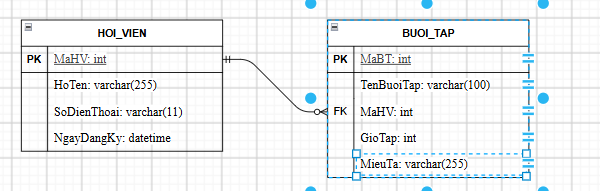

### Các Entity

| **Entity**    | **Attribute cần lưu**        | **Khóa chính (PK) đề xuất** |
| ------------------- | ------------------------------------ | -------------------------------------- |
| HOI_VIEN            | MaHV, HoTen, SoDienThoai, NgayDangKy | MaHV                                   |
| KHOA_HOC (BUOI_TAP) | MaBT,TenBuoiTap, GioTap, MieuTa      | MaBT                                   |
| SDT_HOI_VIEN        | MaHV, SoDienThoai                   |                                        |

### Vẽ ERD:

### Chuẩn Hóa dữ liệu:

| **MaHV** | **HoTen** | **SoDienThoai**  |
| -------------- | --------------- | ---------------------- |
| HV01           | Nguyễn Văn A  | 0901111111, 0902222222 |
| HV02           | Trần Thị B    | 0903333333             |

Cột SoDienThoai đang vi phạm chuẩn của 1NF vì theo quy tắc của 1NF thì một cột của bảng thì chỉ chứa 1 giá trị duy nhất không được chứa đa giá trị 

Các giải quyết ta sẽ tách bảng riêng với HOI_VIEN với thuộc tính SoDienThoai thành SDT_HOI_VIEN

với các thuộc tính: 

+ MaHV: int (FK)
+ MaSDT: int (PK)
+ SoDienThoai: varchar(11)
